# p5.sdf

*Signed distance functions* (SDFs) are a way of representing shapes. Normally, p5 uses triangle meshes for all its 3D shapes. However, this is not always the most expressive way to construct shapes, and some operations like topology changes (imagine some parts of a shape smoothly globbing together) are incredibly difficult to represent that way. An SDF is just a big function that you can evaluate at any point in space to find out how far you are from the surface, so topology changes aren't especially hard, and operations like smooth unions can make it easier to create natural-looking shapes. You render an SDF by raymarching into the scene, advancing the ray until the distance to the surface is effectively zero. <a href="https://iquilezles.org/articles/distfunctions/">Inigo Quilez has a reference of SDF functions</a> (and a number of other blog posts about it, and a number of youtube videos; he's *the* resource for this, check him out!)

This library tries to make it as easy as possible to use these techniques inside of p5.js alongside its traditional shape drawing tools. Create an SDF shape using `push` and `pop` and transformations like `translate`, `rotate`, and `scale` like you would with normal geometry, and get back an object you can call `.draw()` on to render it into a scene. It will work with your usual p5 camera and lighting controls!

## Adding the library

Add it via a script tag:

```html
<script type="text/javascript" src="https://cdn.jsdelivr.net/npm/p5.sdf@0.0.1/p5.sdf.js"></script>
```

Or for OpenProcessing, you can add it directly via CDN:

```
https://cdn.jsdelivr.net/npm/p5.sdf@0.0.1/p5.sdf.js
```

Or fork this project on the p5.js web editor: https://editor.p5js.org/davepagurek/sketches/BHmhdypVb

## Reference

### Structure

Use this addon by calling `buildSDF` in `setup`. The result is an SDF object that you can now use in `draw` by calling its `.draw()` method.

#### buildSDF

<!-- p5.sdf example: buildSDF -->
```
buildSDF(callback)
```

<table>
<tr>
<td>

```js
let shape

function setup() {
  createCanvas(200, 200, WEBGL)
  shape = buildSDF(() => {
    smoothUnion(20)
    sphere(60)
    push()
    translate(50, 0, 0)
    sphere(40)
    pop()
  })
}

function draw() {
  background(30)
  orbitControl()
  ambientLight(70)
  directionalLight(200, 200, 200, 0.3, 0.6, -1)
  specularMaterial(150)
  shininess(100)
  shape.draw()
}
```

</td>
<td>

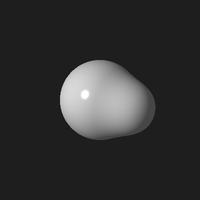

</td>
</tr>
</table>
<!-- /p5.sdf example: buildSDF -->

#### draw

<!-- p5.sdf example: draw -->
```
draw([radius=200])
draw(boundsCallback)
```

<table>
<tr>
<td>

```js
let shape

function setup() {
  createCanvas(200, 200, WEBGL)
  shape = buildSDF(() => {
    fill(255, 120, 60)
    sphere(80)
  })
}

function draw() {
  background(30)
  orbitControl()
  ambientLight(70)
  directionalLight(200, 200, 200, 0.3, 0.6, -1)
  specularMaterial(150)
  shininess(100)
  shape.draw()
}
```

</td>
<td>

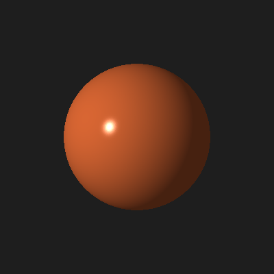

</td>
</tr>
</table>
<!-- /p5.sdf example: draw -->

By default, SDFs are raymarched with in a sphere with a radius of 200. You can pass in your own bounding shape function if you want to use something else that is maybe a tighter fit to your SDF, such as a bounding box.

<!-- p5.sdf example: draw.boundingShape -->
<table>
<tr>
<td>

```js
let shape

function setup() {
  createCanvas(200, 200, WEBGL)
  shape = buildSDF(() => {
    fill(255, 120, 60)
    box(120, 60, 60)
  })
}

function draw() {
  background(30)
  orbitControl()
  ambientLight(70)
  directionalLight(200, 200, 200, 0.3, 0.6, -1)
  specularMaterial(150)
  shininess(100)
  // Covers the shape with a box instead of a sphere
  shape.draw(() => box(160, 100, 100))
}
```

</td>
<td>

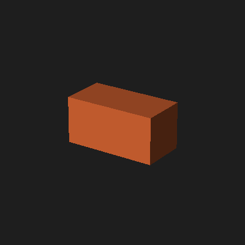

</td>
</tr>
</table>
<!-- /p5.sdf example: draw.boundingShape -->

...or, you can pass in a number to use a bounding sphere at that radius.

<!-- p5.sdf example: draw.radius -->
<table>
<tr>
<td>

```js
let shape

function setup() {
  createCanvas(200, 200, WEBGL)
  shape = buildSDF(() => {
    fill(255, 120, 60)
    sphere(50)
  })
}

function draw() {
  background(30)
  orbitControl()
  ambientLight(70)
  directionalLight(200, 200, 200, 0.3, 0.6, -1)
  specularMaterial(150)
  shininess(100)

  push()
  translate(-60, 0, 0)
  shape.draw(100)
  pop()

  push()
  translate(60, 0, 0)
  noStroke()
  fill(80, 160, 255)
  sphere(50)
  pop()
}
```

</td>
<td>

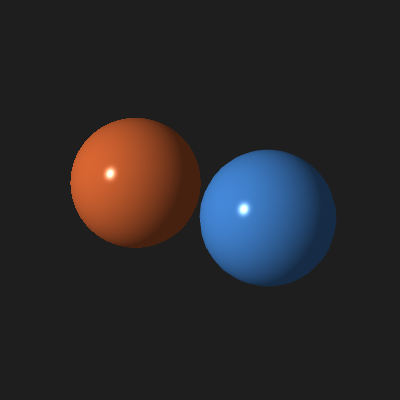

</td>
</tr>
</table>
<!-- /p5.sdf example: draw.radius -->

### Primitives

Within `buildSDF`, you have a number of primitive shapes that you can use and combine. Many mirror existing p5 geometry, but there are also a few more.

#### sphere

<!-- p5.sdf example: sphere -->
```
sphere([radius])
```

<table>
<tr>
<td>

```js
let shape

function setup() {
  createCanvas(200, 200, WEBGL)
  shape = buildSDF(() => {
    sphere(80)
  })
}

function draw() {
  background(30)
  orbitControl()
  ambientLight(70)
  directionalLight(200, 200, 200, 0.3, 0.6, -1)
  specularMaterial(150)
  shininess(100)
  shape.draw()
}
```

</td>
<td>

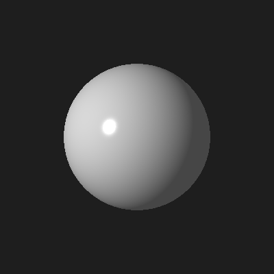

</td>
</tr>
</table>
<!-- /p5.sdf example: sphere -->

#### box

<!-- p5.sdf example: box -->
```
box([width], [height], [depth])
```

<table>
<tr>
<td>

```js
let shape

function setup() {
  createCanvas(200, 200, WEBGL)
  shape = buildSDF(() => {
    box(120)
  })
}

function draw() {
  background(30)
  orbitControl()
  ambientLight(70)
  directionalLight(200, 200, 200, 0.3, 0.6, -1)
  specularMaterial(150)
  shininess(100)
  shape.draw()
}
```

</td>
<td>

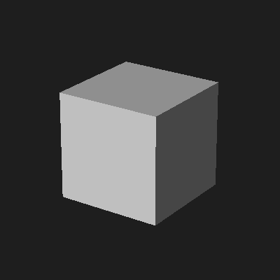

</td>
</tr>
</table>
<!-- /p5.sdf example: box -->

#### roundBox

While there is a more general `rounded()` helper in the Modifiers section below, that one works by inflating a shape by a given radius. That's what's necessary to make a fully general rounding mechanism, but for a rounded box specifically, we can round its corners without that general inflation happening, where the width/height/depth you pass in is what you get as output, just with the corners sanded off.

<!-- p5.sdf example: roundBox -->
```
roundBox(width, height, depth, radius)
```

<table>
<tr>
<td>

```js
let shape

function setup() {
  createCanvas(200, 200, WEBGL)
  shape = buildSDF(() => {
    roundBox(120, 120, 120, 15)
  })
}

function draw() {
  background(30)
  orbitControl()
  ambientLight(70)
  directionalLight(200, 200, 200, 0.3, 0.6, -1)
  specularMaterial(150)
  shininess(100)
  shape.draw()
}
```

</td>
<td>

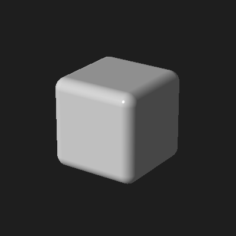

</td>
</tr>
</table>
<!-- /p5.sdf example: roundBox -->

#### boxFrame

<!-- p5.sdf example: boxFrame -->
```
boxFrame(width, height, depth, thickness)
```

<table>
<tr>
<td>

```js
let shape

function setup() {
  createCanvas(200, 200, WEBGL)
  shape = buildSDF(() => {
    boxFrame(120, 120, 120, 8)
  })
}

function draw() {
  background(30)
  orbitControl()
  ambientLight(70)
  directionalLight(200, 200, 200, 0.3, 0.6, -1)
  specularMaterial(150)
  shininess(100)
  shape.draw()
}
```

</td>
<td>

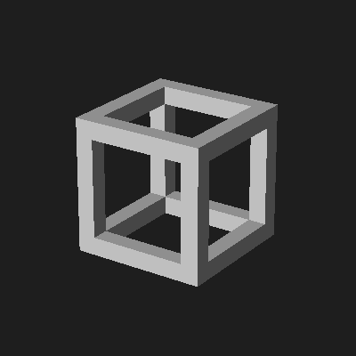

</td>
</tr>
</table>
<!-- /p5.sdf example: boxFrame -->

#### cylinder

<!-- p5.sdf example: cylinder -->
```
cylinder([radius], [height])
```

<table>
<tr>
<td>

```js
let shape

function setup() {
  createCanvas(200, 200, WEBGL)
  shape = buildSDF(() => {
    cylinder(60, 120)
  })
}

function draw() {
  background(30)
  orbitControl()
  ambientLight(70)
  directionalLight(200, 200, 200, 0.3, 0.6, -1)
  specularMaterial(150)
  shininess(100)
  shape.draw()
}
```

</td>
<td>

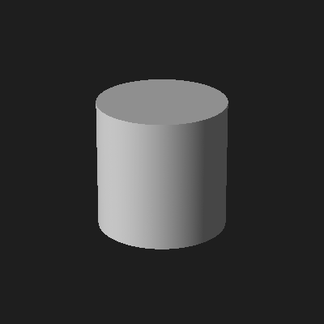

</td>
</tr>
</table>
<!-- /p5.sdf example: cylinder -->

#### capsule

<!-- p5.sdf example: capsule -->
```
capsule(height, radius)
```

<table>
<tr>
<td>

```js
let shape

function setup() {
  createCanvas(200, 200, WEBGL)
  shape = buildSDF(() => {
    translate(0, -40, 0)
    capsule(80, 40)
  })
}

function draw() {
  background(30)
  orbitControl()
  ambientLight(70)
  directionalLight(200, 200, 200, 0.3, 0.6, -1)
  specularMaterial(150)
  shininess(100)
  shape.draw()
}
```

</td>
<td>

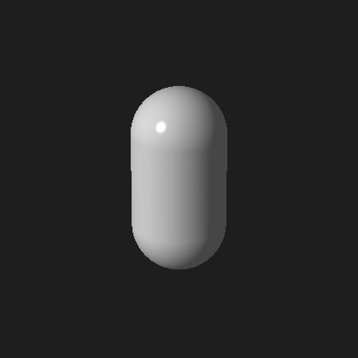

</td>
</tr>
</table>
<!-- /p5.sdf example: capsule -->

#### torus

<!-- p5.sdf example: torus -->
```
torus([radius], [tubeRadius])
```

<table>
<tr>
<td>

```js
let shape

function setup() {
  createCanvas(200, 200, WEBGL)
  shape = buildSDF(() => {
    torus(70, 25)
  })
}

function draw() {
  background(30)
  orbitControl()
  ambientLight(70)
  directionalLight(200, 200, 200, 0.3, 0.6, -1)
  specularMaterial(150)
  shininess(100)
  shape.draw()
}
```

</td>
<td>

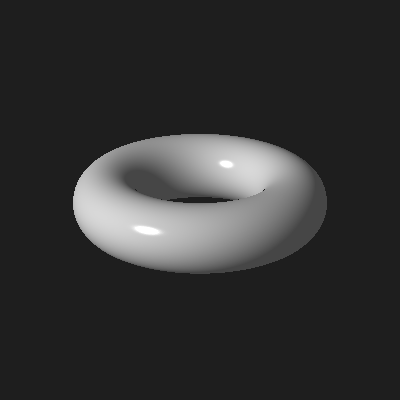

</td>
</tr>
</table>
<!-- /p5.sdf example: torus -->

#### plane

<!-- p5.sdf example: plane -->
```
plane([width], [height])
```

<table>
<tr>
<td>

```js
let shape

function setup() {
  createCanvas(200, 200, WEBGL)
  shape = buildSDF(() => {
    plane(120, 80)
  })
}

function draw() {
  background(30)
  orbitControl()
  ambientLight(70)
  directionalLight(200, 200, 200, 0.3, 0.6, -1)
  specularMaterial(150)
  shininess(100)
  shape.draw()
}
```

</td>
<td>


</td>
</tr>
</table>
<!-- /p5.sdf example: plane -->

#### infinitePlane

<!-- p5.sdf example: infinitePlane -->
```
infinitePlane(nx, ny, nz, offset)
```

<table>
<tr>
<td>

```js
let shape

function setup() {
  createCanvas(200, 200, WEBGL)
  shape = buildSDF(() => {
    sphere(90)
    intersect()
    infinitePlane(0, 1, 0, 0)
  })
}

function draw() {
  background(30)
  orbitControl()
  ambientLight(70)
  directionalLight(200, 200, 200, 0.3, 0.6, -1)
  specularMaterial(150)
  shininess(100)
  shape.draw()
}
```

</td>
<td>

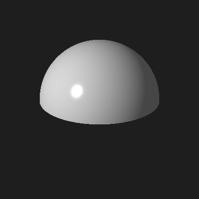

</td>
</tr>
</table>
<!-- /p5.sdf example: infinitePlane -->

#### ellipsoid

<!-- p5.sdf example: ellipsoid -->
```
ellipsoid([radiusX], [radiusY], [radiusZ])
```

<table>
<tr>
<td>

```js
let shape

function setup() {
  createCanvas(200, 200, WEBGL)
  shape = buildSDF(() => {
    ellipsoid(90, 55, 45)
  })
}

function draw() {
  background(30)
  orbitControl()
  ambientLight(70)
  directionalLight(200, 200, 200, 0.3, 0.6, -1)
  specularMaterial(150)
  shininess(100)
  shape.draw()
}
```

</td>
<td>

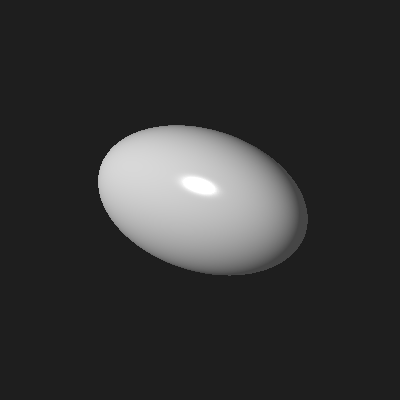

</td>
</tr>
</table>
<!-- /p5.sdf example: ellipsoid -->

#### cone

<!-- p5.sdf example: cone -->
```
cone([radius], [height])
```

<table>
<tr>
<td>

```js
let shape

function setup() {
  createCanvas(200, 200, WEBGL)
  shape = buildSDF(() => {
    cone(60, 120)
  })
}

function draw() {
  background(30)
  orbitControl()
  ambientLight(70)
  directionalLight(200, 200, 200, 0.3, 0.6, -1)
  specularMaterial(150)
  shininess(100)
  shape.draw()
}
```

</td>
<td>

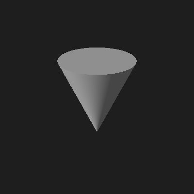

</td>
</tr>
</table>
<!-- /p5.sdf example: cone -->

#### octahedron

<!-- p5.sdf example: octahedron -->
```
octahedron(size)
```

<table>
<tr>
<td>

```js
let shape

function setup() {
  createCanvas(200, 200, WEBGL)
  shape = buildSDF(() => {
    octahedron(90)
  })
}

function draw() {
  background(30)
  orbitControl()
  ambientLight(70)
  directionalLight(200, 200, 200, 0.3, 0.6, -1)
  specularMaterial(150)
  shininess(100)
  shape.draw()
}
```

</td>
<td>

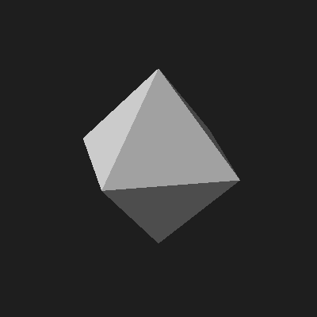

</td>
</tr>
</table>
<!-- /p5.sdf example: octahedron -->

### Transformations

These are generally the same as in regular p5! But there are a few extra additions that are unique to SDFs, such as mirroring the space or applying twists or other warps.

#### translate

<!-- p5.sdf example: translate -->
```
translate(x, [y], [z])
translate(vector)
```

<table>
<tr>
<td>

```js
let shape

function setup() {
  createCanvas(200, 200, WEBGL)
  shape = buildSDF(() => {
    translate(-50, 0, 0)
    sphere(40)
    translate(100, 0, 0)
    sphere(40)
  })
}

function draw() {
  background(30)
  orbitControl()
  ambientLight(70)
  directionalLight(200, 200, 200, 0.3, 0.6, -1)
  specularMaterial(150)
  shininess(100)
  shape.draw()
}
```

</td>
<td>

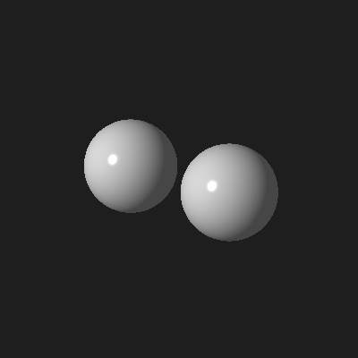

</td>
</tr>
</table>
<!-- /p5.sdf example: translate -->

#### scale

<!-- p5.sdf example: scale -->
```
scale(factor)
scale(x, y, [z])
scale(vector)
```

<table>
<tr>
<td>

```js
let shape

function setup() {
  createCanvas(200, 200, WEBGL)
  shape = buildSDF(() => {
    box(60)
    translate(100, 0, 0)
    scale(0.5)
    box(60)
  })
}

function draw() {
  background(30)
  orbitControl()
  ambientLight(70)
  directionalLight(200, 200, 200, 0.3, 0.6, -1)
  specularMaterial(150)
  shininess(100)
  shape.draw()
}
```

</td>
<td>

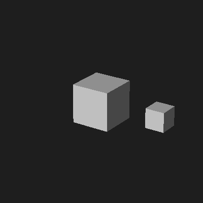

</td>
</tr>
</table>
<!-- /p5.sdf example: scale -->

#### rotate

<!-- p5.sdf example: rotate -->
```
rotate(angle, [axis])
```

<table>
<tr>
<td>

```js
let shape

function setup() {
  createCanvas(200, 200, WEBGL)
  shape = buildSDF(() => {
    rotate(0.8, [1, 1, 0])
    box(120, 40, 80)
  })
}

function draw() {
  background(30)
  orbitControl()
  ambientLight(70)
  directionalLight(200, 200, 200, 0.3, 0.6, -1)
  specularMaterial(150)
  shininess(100)
  shape.draw()
}
```

</td>
<td>

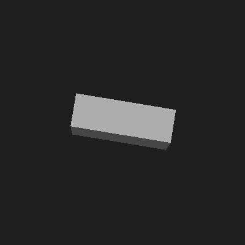

</td>
</tr>
</table>
<!-- /p5.sdf example: rotate -->

#### rotateX

<!-- p5.sdf example: rotateX -->
```
rotateX(angle)
```

<table>
<tr>
<td>

```js
let shape

function setup() {
  createCanvas(200, 200, WEBGL)
  shape = buildSDF(() => {
    rotateX(0.7)
    box(120, 40, 80)
  })
}

function draw() {
  background(30)
  orbitControl()
  ambientLight(70)
  directionalLight(200, 200, 200, 0.3, 0.6, -1)
  specularMaterial(150)
  shininess(100)
  shape.draw()
}
```

</td>
<td>

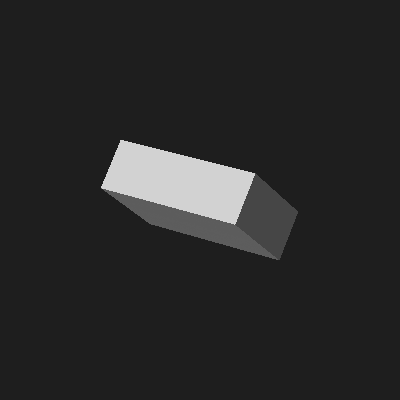

</td>
</tr>
</table>
<!-- /p5.sdf example: rotateX -->

#### rotateY

<!-- p5.sdf example: rotateY -->
```
rotateY(angle)
```

<table>
<tr>
<td>

```js
let shape

function setup() {
  createCanvas(200, 200, WEBGL)
  shape = buildSDF(() => {
    rotateY(0.7)
    box(120, 40, 80)
  })
}

function draw() {
  background(30)
  orbitControl()
  ambientLight(70)
  directionalLight(200, 200, 200, 0.3, 0.6, -1)
  specularMaterial(150)
  shininess(100)
  shape.draw()
}
```

</td>
<td>

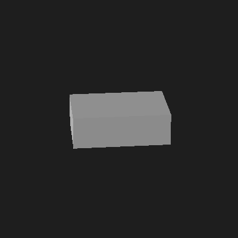

</td>
</tr>
</table>
<!-- /p5.sdf example: rotateY -->

#### rotateZ

<!-- p5.sdf example: rotateZ -->
```
rotateZ(angle)
```

<table>
<tr>
<td>

```js
let shape

function setup() {
  createCanvas(200, 200, WEBGL)
  shape = buildSDF(() => {
    rotateZ(0.7)
    box(120, 40, 80)
  })
}

function draw() {
  background(30)
  orbitControl()
  ambientLight(70)
  directionalLight(200, 200, 200, 0.3, 0.6, -1)
  specularMaterial(150)
  shininess(100)
  shape.draw()
}
```

</td>
<td>

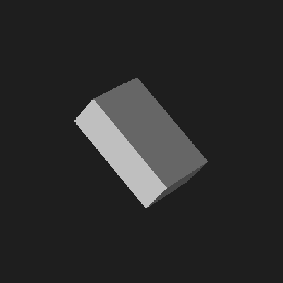

</td>
</tr>
</table>
<!-- /p5.sdf example: rotateZ -->

#### shearX

<!-- p5.sdf example: shearX -->
```
shearX(angle)
```

<table>
<tr>
<td>

```js
let shape

function setup() {
  createCanvas(200, 200, WEBGL)
  shape = buildSDF(() => {
    shearX(0.5)
    box(80)
  })
}

function draw() {
  background(30)
  orbitControl()
  ambientLight(70)
  directionalLight(200, 200, 200, 0.3, 0.6, -1)
  specularMaterial(150)
  shininess(100)
  shape.draw()
}
```

</td>
<td>

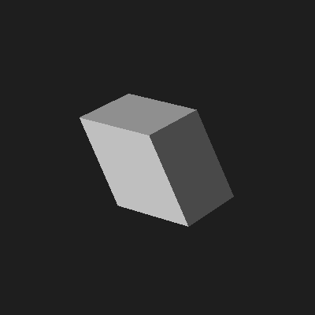

</td>
</tr>
</table>
<!-- /p5.sdf example: shearX -->

#### shearY

<!-- p5.sdf example: shearY -->
```
shearY(angle)
```

<table>
<tr>
<td>

```js
let shape

function setup() {
  createCanvas(200, 200, WEBGL)
  shape = buildSDF(() => {
    shearY(0.5)
    box(80)
  })
}

function draw() {
  background(30)
  orbitControl()
  ambientLight(70)
  directionalLight(200, 200, 200, 0.3, 0.6, -1)
  specularMaterial(150)
  shininess(100)
  shape.draw()
}
```

</td>
<td>

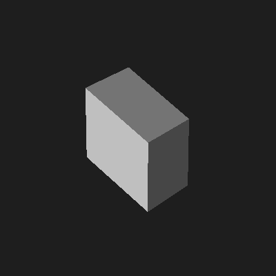

</td>
</tr>
</table>
<!-- /p5.sdf example: shearY -->

#### mirror

<!-- p5.sdf example: mirror -->
```
mirror(axis)
```

<table>
<tr>
<td>

```js
let shape

function setup() {
  createCanvas(200, 200, WEBGL)
  shape = buildSDF(() => {
    mirror('x')
    translate(60, 0, 0)
    rotateZ(0.6)
    box(80, 30, 30)
  })
}

function draw() {
  background(30)
  orbitControl()
  ambientLight(70)
  directionalLight(200, 200, 200, 0.3, 0.6, -1)
  specularMaterial(150)
  shininess(100)
  shape.draw()
}
```

</td>
<td>

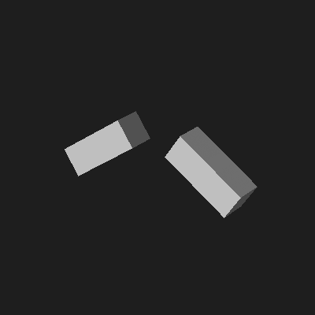

</td>
</tr>
</table>
<!-- /p5.sdf example: mirror -->

#### elongate

This works kind of like 9-slice-scaling in 2D. It cuts up space along the x, y, and z axes, and then pushes apart the ends by the distances you provide. The pieces that get moved apart stay connected, essentially using them just as corners.

<!-- p5.sdf example: elongate -->
```
elongate(x, y, z)
```

<table>
<tr>
<td>

```js
let shape

function setup() {
  createCanvas(200, 200, WEBGL)
  shape = buildSDF(() => {
    elongate(40, 0, 0)
    sphere(40)
  })
}

function draw() {
  background(30)
  orbitControl()
  ambientLight(70)
  directionalLight(200, 200, 200, 0.3, 0.6, -1)
  specularMaterial(150)
  shininess(100)
  shape.draw()
}
```

</td>
<td>

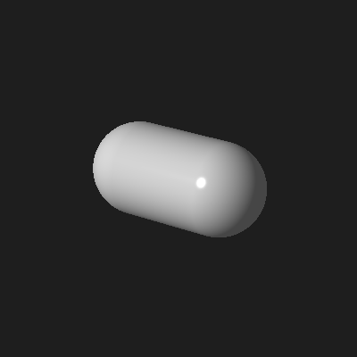

</td>
</tr>
</table>
<!-- /p5.sdf example: elongate -->

#### twist

Twists about the y axis (vertical). To get other axes, rotate first, twist, then un-rotate.

<!-- p5.sdf example: twist -->
```
twist(amount)
```

<table>
<tr>
<td>

```js
let shape

function setup() {
  createCanvas(200, 200, WEBGL)
  shape = buildSDF(() => {
    twist(0.04)
    box(60, 140, 60)
  })
}

function draw() {
  background(30)
  orbitControl()
  ambientLight(70)
  directionalLight(200, 200, 200, 0.3, 0.6, -1)
  specularMaterial(150)
  shininess(100)
  shape.draw()
}
```

</td>
<td>

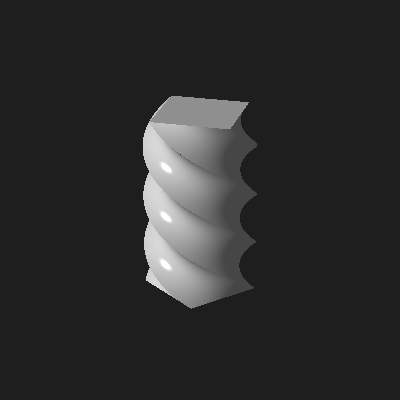

</td>
</tr>
</table>
<!-- /p5.sdf example: twist -->

#### bend

Bends about the z axis (into and out of the screen). To get other axes, rotate first, bend, then un-rotate.

<!-- p5.sdf example: bend -->
```
bend(amount)
```

<table>
<tr>
<td>

```js
let shape

function setup() {
  createCanvas(200, 200, WEBGL)
  shape = buildSDF(() => {
    bend(0.006)
    rotateZ(Math.PI / 2)
    cylinder(25, 180)
  })
}

function draw() {
  background(30)
  orbitControl()
  ambientLight(70)
  directionalLight(200, 200, 200, 0.3, 0.6, -1)
  specularMaterial(150)
  shininess(100)
  shape.draw()
}
```

</td>
<td>

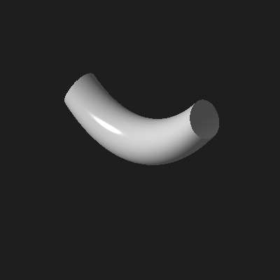

</td>
</tr>
</table>
<!-- /p5.sdf example: bend -->

### Materials

p5 material modifiers work here too! (Notable exception is `texture()`. I still need to figure out how to support that.)

#### fill

<!-- p5.sdf example: fill -->
```
fill(gray)
fill(r, g, b)
fill(color)
```

<table>
<tr>
<td>

```js
let shape

function setup() {
  createCanvas(200, 200, WEBGL)
  shape = buildSDF(() => {
    fill(255, 80, 80)
    sphere(80)
  })
}

function draw() {
  background(30)
  orbitControl()
  ambientLight(70)
  directionalLight(200, 200, 200, 0.3, 0.6, -1)
  specularMaterial(150)
  shininess(100)
  shape.draw()
}
```

</td>
<td>

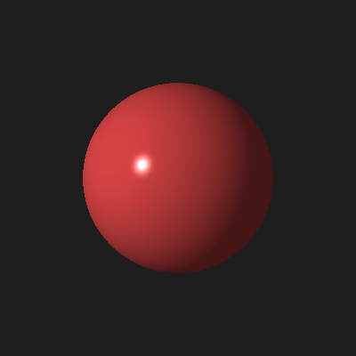

</td>
</tr>
</table>
<!-- /p5.sdf example: fill -->

#### ambientMaterial

<!-- p5.sdf example: ambientMaterial -->
```
ambientMaterial(gray)
ambientMaterial(r, g, b)
ambientMaterial(color)
```

<table>
<tr>
<td>

```js
let shape

function setup() {
  createCanvas(200, 200, WEBGL)
  shape = buildSDF(() => {
    ambientMaterial(255, 80, 80)
    sphere(80)
  })
}

function draw() {
  background(30)
  orbitControl()
  ambientLight(70)
  directionalLight(200, 200, 200, 0.3, 0.6, -1)
  specularMaterial(150)
  shininess(100)
  shape.draw()
}
```

</td>
<td>

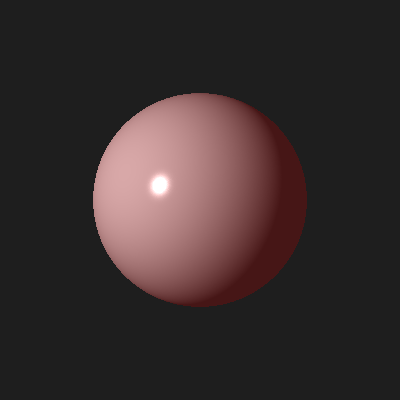

</td>
</tr>
</table>
<!-- /p5.sdf example: ambientMaterial -->

#### specularMaterial

<!-- p5.sdf example: specularMaterial -->
```
specularMaterial(gray)
specularMaterial(r, g, b)
specularMaterial(color)
```

<table>
<tr>
<td>

```js
let shape

function setup() {
  createCanvas(200, 200, WEBGL)
  shape = buildSDF(() => {
    fill(120)
    specularMaterial(0, 255, 0)
    shininess(20)
    sphere(80)
  })
}

function draw() {
  background(30)
  orbitControl()
  ambientLight(70)
  directionalLight(200, 200, 200, 0.3, 0.6, -1)
  specularMaterial(150)
  shininess(100)
  shape.draw()
}
```

</td>
<td>

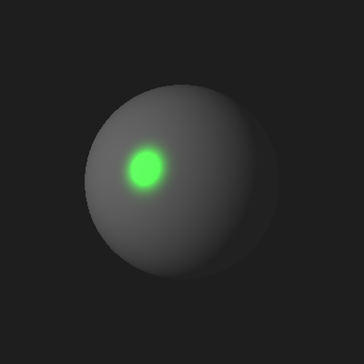

</td>
</tr>
</table>
<!-- /p5.sdf example: specularMaterial -->

#### emissiveMaterial

<!-- p5.sdf example: emissiveMaterial -->
```
emissiveMaterial(gray)
emissiveMaterial(r, g, b)
emissiveMaterial(color)
```

<table>
<tr>
<td>

```js
let shape

function setup() {
  createCanvas(200, 200, WEBGL)
  shape = buildSDF(() => {
    fill(60)
    emissiveMaterial(0, 70, 140)
    sphere(80)
  })
}

function draw() {
  background(30)
  orbitControl()
  ambientLight(70)
  directionalLight(200, 200, 200, 0.3, 0.6, -1)
  specularMaterial(150)
  shininess(100)
  shape.draw()
}
```

</td>
<td>

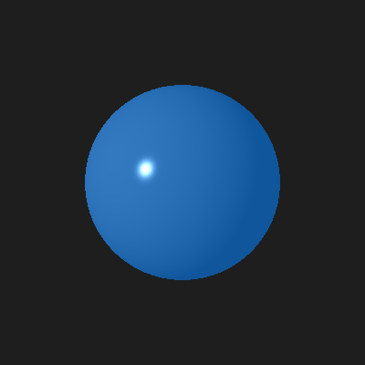

</td>
</tr>
</table>
<!-- /p5.sdf example: emissiveMaterial -->

#### shininess

<!-- p5.sdf example: shininess -->
```
shininess(amount)
```

<table>
<tr>
<td>

```js
let shape

function setup() {
  createCanvas(200, 200, WEBGL)
  shape = buildSDF(() => {
    translate(-60, 0, 0)
    shininess(5)
    sphere(50)
    translate(120, 0, 0)
    shininess(40)
    sphere(50)
  })
}

function draw() {
  background(30)
  orbitControl()
  ambientLight(70)
  directionalLight(200, 200, 200, 0.3, 0.6, -1)
  specularMaterial(150)
  shininess(100)
  shape.draw()
}
```

</td>
<td>

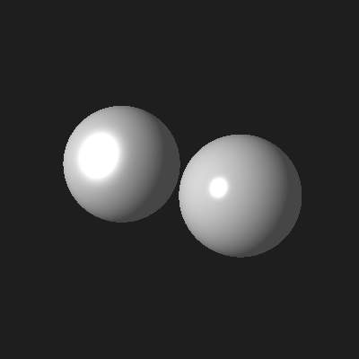

</td>
</tr>
</table>
<!-- /p5.sdf example: shininess -->

#### metalness

<!-- p5.sdf example: metalness -->
```
metalness(amount)
```

<table>
<tr>
<td>

```js
let shape
let environment

async function setup() {
  createCanvas(200, 200, WEBGL)
  environment = await loadImage('outdoor_spheremap.jpg')
  shape = buildSDF(() => {
    translate(-60, 0, 0)
    metalness(0)
    sphere(50)
    translate(120, 0, 0)
    metalness(1)
    sphere(50)
  })
}

function draw() {
  background(30)
  orbitControl()
  imageLight(environment)
  specularMaterial(150)
  shininess(100)
  shape.draw()
}
```

</td>
<td>

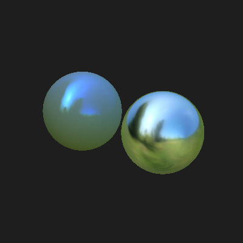

</td>
</tr>
</table>
<!-- /p5.sdf example: metalness -->

### Modifiers

These are kind of like geometry filters that you can run on shapes. They take in a callback function, allowing you to apply them to just the shapes drawn in the callback. The callback has an implicit `push` and `pop` around it so that state changes in the callback don't leak out.

#### rounded

This rounds corners by inflating the shape by a given radius. (To get a rounded box by sanding down corners rather than inflating, use `roundBox`.)

<!-- p5.sdf example: rounded -->
```
rounded(radius, callback)
```

<table>
<tr>
<td>

```js
let shape

function setup() {
  createCanvas(200, 200, WEBGL)
  shape = buildSDF(() => {
    rounded(12, () => {
      box(100)
    })
  })
}

function draw() {
  background(30)
  orbitControl()
  ambientLight(70)
  directionalLight(200, 200, 200, 0.3, 0.6, -1)
  specularMaterial(150)
  shininess(100)
  shape.draw()
}
```

</td>
<td>

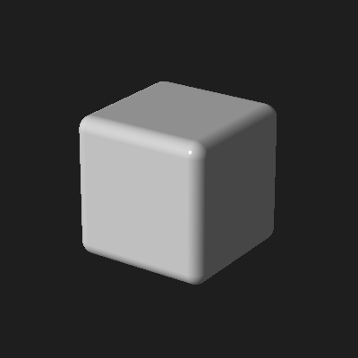

</td>
</tr>
</table>
<!-- /p5.sdf example: rounded -->

#### onion

This modifier turns a solid shape into a hollow shell with a given thickness.

<!-- p5.sdf example: onion -->
```
onion(thickness, callback)
```

<table>
<tr>
<td>

```js
let shape

function setup() {
  createCanvas(200, 200, WEBGL)
  shape = buildSDF(() => {
    onion(6, () => {
      sphere(80)
    })
    intersect()
    infinitePlane(0, 0, 1, 0)
  })
}

function draw() {
  background(30)
  orbitControl()
  ambientLight(70)
  directionalLight(200, 200, 200, 0.3, 0.6, -1)
  specularMaterial(150)
  shininess(100)
  shape.draw()
}
```

</td>
<td>

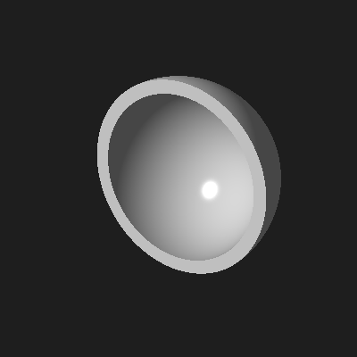

</td>
</tr>
</table>
<!-- /p5.sdf example: onion -->

<!-- p5.sdf example: onion.layers -->
<table>
<tr>
<td>

```js
let shape

function setup() {
  createCanvas(200, 200, WEBGL)
  shape = buildSDF(() => {
    onion(2, () => {
      onion(6, () => {
        onion(14, () => {
          sphere(90)
        })
      })
    })
    intersect()
    infinitePlane(0, 0, 1, 0)
  })
}

function draw() {
  background(30)
  orbitControl()
  ambientLight(70)
  directionalLight(200, 200, 200, 0.3, 0.6, -1)
  specularMaterial(150)
  shininess(100)
  shape.draw()
}
```

</td>
<td>

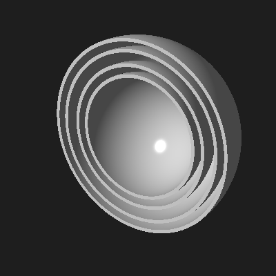

</td>
</tr>
</table>
<!-- /p5.sdf example: onion.layers -->

### Operations

You can combine multiple shapes into one SDF using different operations. Once you've set an operation, subsequent shapes that you add will be merged in using it. The default operation is `union`, which just shows all the things, kind of like just drawing stuff to the canvas normally in p5. But the other ones are unique to SDFs!

There are your standard boolean operators, but there are also `smooth` versions. Try using those and changing the blend amount! It's one of the main draws of using SDFs, helping create more natural shapes.

#### union

<!-- p5.sdf example: union -->
```
union()
```

<table>
<tr>
<td>

```js
let shape

function setup() {
  createCanvas(200, 200, WEBGL)
  shape = buildSDF(() => {
    sphere(55)
    translate(50, 0, 0)
    sphere(55)
  })
}

function draw() {
  background(30)
  orbitControl()
  ambientLight(70)
  directionalLight(200, 200, 200, 0.3, 0.6, -1)
  specularMaterial(150)
  shininess(100)
  shape.draw()
}
```

</td>
<td>

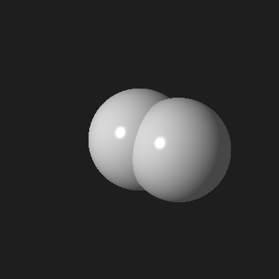

</td>
</tr>
</table>
<!-- /p5.sdf example: union -->

#### subtract

<!-- p5.sdf example: subtract -->
```
subtract()
```

<table>
<tr>
<td>

```js
let shape

function setup() {
  createCanvas(200, 200, WEBGL)
  shape = buildSDF(() => {
    sphere(75)
    subtract()
    cylinder(35, 200)
  })
}

function draw() {
  background(30)
  orbitControl()
  ambientLight(70)
  directionalLight(200, 200, 200, 0.3, 0.6, -1)
  specularMaterial(150)
  shininess(100)
  shape.draw()
}
```

</td>
<td>

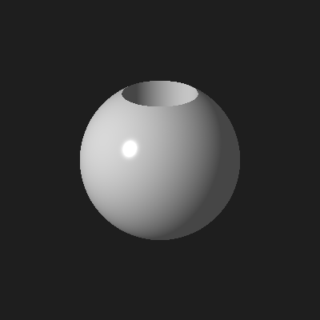

</td>
</tr>
</table>
<!-- /p5.sdf example: subtract -->

#### intersect

<!-- p5.sdf example: intersect -->
```
intersect()
```

<table>
<tr>
<td>

```js
let shape

function setup() {
  createCanvas(200, 200, WEBGL)
  shape = buildSDF(() => {
    sphere(80)
    intersect()
    box(100)
  })
}

function draw() {
  background(30)
  orbitControl()
  ambientLight(70)
  directionalLight(200, 200, 200, 0.3, 0.6, -1)
  specularMaterial(150)
  shininess(100)
  shape.draw()
}
```

</td>
<td>

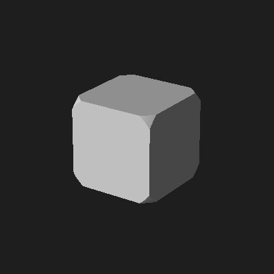

</td>
</tr>
</table>
<!-- /p5.sdf example: intersect -->

#### smoothUnion

<!-- p5.sdf example: smoothUnion -->
```
smoothUnion(amount)
```

<table>
<tr>
<td>

```js
let shape

function setup() {
  createCanvas(200, 200, WEBGL)
  shape = buildSDF(() => {
    smoothUnion(30)
    translate(-35, 0, 0)
    sphere(50)
    translate(70, 0, 0)
    sphere(50)
  })
}

function draw() {
  background(30)
  orbitControl()
  ambientLight(70)
  directionalLight(200, 200, 200, 0.3, 0.6, -1)
  specularMaterial(150)
  shininess(100)
  shape.draw()
}
```

</td>
<td>

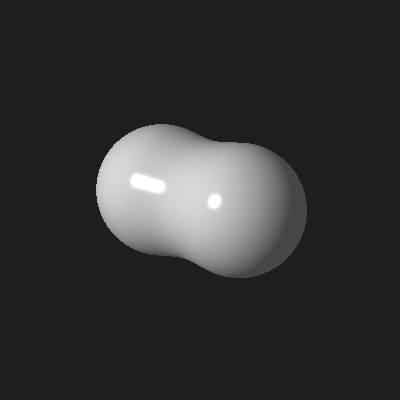

</td>
</tr>
</table>
<!-- /p5.sdf example: smoothUnion -->

#### smoothSubtract

<!-- p5.sdf example: smoothSubtract -->
```
smoothSubtract(amount)
```

<table>
<tr>
<td>

```js
let shape

function setup() {
  createCanvas(200, 200, WEBGL)
  shape = buildSDF(() => {
    sphere(75)
    smoothSubtract(25)
    cylinder(45, 200)
  })
}

function draw() {
  background(30)
  orbitControl()
  ambientLight(70)
  directionalLight(200, 200, 200, 0.3, 0.6, -1)
  specularMaterial(150)
  shininess(100)
  shape.draw()
}
```

</td>
<td>

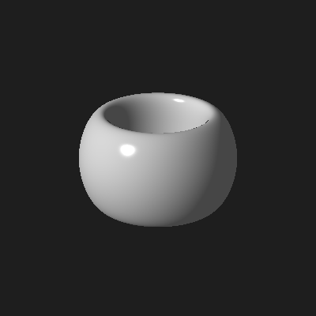

</td>
</tr>
</table>
<!-- /p5.sdf example: smoothSubtract -->

#### smoothIntersect

<!-- p5.sdf example: smoothIntersect -->
```
smoothIntersect(amount)
```

<table>
<tr>
<td>

```js
let shape

function setup() {
  createCanvas(200, 200, WEBGL)
  shape = buildSDF(() => {
    sphere(80)
    smoothIntersect(30)
    box(100)
  })
}

function draw() {
  background(30)
  orbitControl()
  ambientLight(70)
  directionalLight(200, 200, 200, 0.3, 0.6, -1)
  specularMaterial(150)
  shininess(100)
  shape.draw()
}
```

</td>
<td>

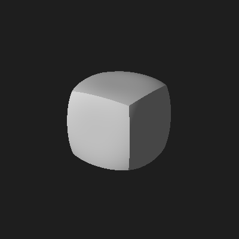

</td>
</tr>
</table>
<!-- /p5.sdf example: smoothIntersect -->

### Examples

<!-- p5.sdf example: blendedMaterials -->
<table>
<tr>
<td>

```js
let shape

function setup() {
  createCanvas(200, 200, WEBGL)
  shape = buildSDF(() => {
    smoothUnion(40)
    fill(255, 80, 80)
    translate(-45, 0, 0)
    sphere(50)
    fill(80, 80, 255)
    translate(90, 0, 0)
    sphere(50)
  })
}

function draw() {
  background(30)
  orbitControl()
  ambientLight(70)
  directionalLight(200, 200, 200, 0.3, 0.6, -1)
  specularMaterial(150)
  shininess(100)
  shape.draw()
}
```

</td>
<td>

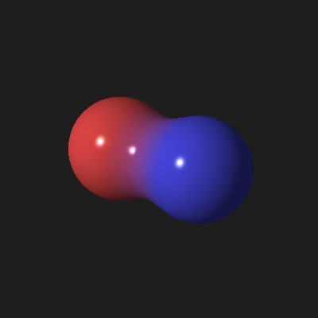

</td>
</tr>
</table>
<!-- /p5.sdf example: blendedMaterials -->

<!-- p5.sdf example: loops -->
<table>
<tr>
<td>

```js
let shape

function setup() {
  createCanvas(200, 200, WEBGL)
  shape = buildSDF(() => {
    smoothUnion(20)
    for (let i = 0; i < 8; i++) {
      push()
      rotateY(i * Math.PI / 4)
      translate(70, 0, 0)
      sphere(22)
      pop()
    }
  })
}

function draw() {
  background(30)
  orbitControl()
  ambientLight(70)
  directionalLight(200, 200, 200, 0.3, 0.6, -1)
  specularMaterial(150)
  shininess(100)
  shape.draw()
}
```

</td>
<td>

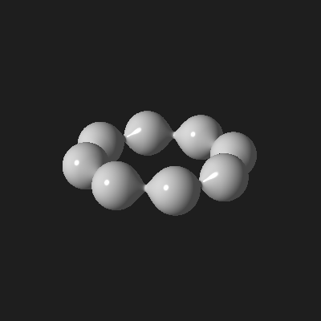

</td>
</tr>
</table>
<!-- /p5.sdf example: loops -->
